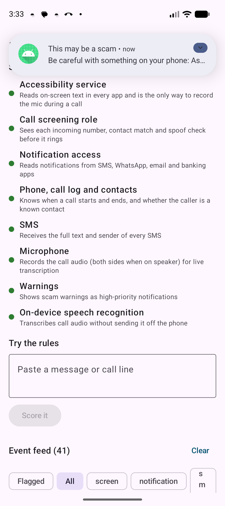

# Pip, the Personal Cyber Defender

Pip is a personal cyber defense agent for Android. This repo holds Pip and the tools we built him with:

- **The Pip app** (`apps/pip-app`), an Android playground app (`dev.playground.pip`) that watches for
  scams: an accessibility service, call screening, SMS and notification capture, call audio capture with on-device
  speech recognition, a rule-based scam scorer, and a playground UI.
- **Pip**, the mascot the app draws over every other app. Pip has two renderers: a Kotlin keyframe engine with a
  full showreel (`ui/anim`, `ui/show`, `ui/Pip*`), and a Rive overlay (`ui/PipRive.kt`) that plays a `.riv`.
- **rivc** (`packages/rivc`), our own compiler from JSON + SVG sources to Rive `.riv` files, so agents can author
  Rive animation as text. With **rivc-preview** (`packages/rivc-preview`), a live-reloading browser previewer and
  golden screenshot tests on the same pinned web runtime.
- **Pip on Rive** (`packages/pip-rive`): Pip's rig, the showreel and HODOR as rivc sources, compiled to `.riv`
  files the app bundles. It has no Android code; the app depends on it.
- **Mock calls** (`tools/mock-calls`): scripted scam calls, injected into the emulator's
  microphone so the app hears them as call audio.
- **Showreel tools** (`tools/pip-show`, `tools/pip-art`): the soundtrack synthesiser and recorder, and the SVG and
  scenery generators.



Coding agents: start with [AGENTS.md](AGENTS.md); to animate Pip or write a story, the
[`animating-pip` skill](.claude/skills/animating-pip/SKILL.md).

Design write-ups are in [docs/](docs/README.md).

## Get started

macOS on Apple Silicon, with [Homebrew](https://brew.sh) and Node:

```sh
npx turbo dev   # first time; setup installs the turbo CLI globally
turbo dev       # every time after: everything, plus the toy menu
turbo droid     # just Android: emulator + logcat
turbo jev       # just jev-playground on :3100
turbo demo      # ready to show Pip on the connected device (see below)
```

**Showing Pip to someone:** connect a phone with USB debugging on (or start the emulator with `turbo droid`), then
`turbo demo`. It picks the connected device (a phone over an emulator; `-- --device <serial>` to choose), builds the
app, installs it fresh (uninstalling the old app and clearing pushed `.riv` files), grants everything over adb
(listing any grant a phone refuses), fetches the speech model, resets the demo state (mute rule, experiments off,
Pip's voice, the first-run greeting), goes home and prints the demo script. `-- --no-build` reuses the last build,
`-- --fixtures` also installs the scenario fixture apps. With no device connected it says what to check and exits.
`turbo demo:reset` only re-arms the greeting on the installed app, so you can show it again: the next open shows
setup, and the open after it greets.

Every turbo task first runs `//#setup` (`scripts/setup.sh`). It checks whether this machine is bootstrapped and
installs only what is missing, then records what it set up in `.pip/setup.lock` (gitignored). When nothing changed,
it takes about half a second and prints nothing (`outputLogs: errors-only`), so on a set-up machine you never see it.
It reruns a step when that step's inputs change:
- **Tools** (`scripts/bootstrap.sh`): Homebrew's `openjdk@21`, `node@24` (`.nvmrc`), `python`, `ffmpeg`, `potrace`,
  `cairo`; pnpm via corepack; the Android command-line tools, platform-tools, emulator, build-tools 37.0.0,
  `platforms;android-36` and the `android-37.0` Google Play arm64 image; an AVD `Pip_API_37` (mic in, speaker off,
  hardware keyboard); the Python venv at `tools/.venv`; Playwright's Chromium. Reruns when `bootstrap.sh`, `.nvmrc`
  or the Python requirements change, or when a tool is missing.
- **JS dependencies** (`pnpm install --frozen-lockfile`): reruns when `pnpm-lock.yaml` or any `package.json`
  changes, or when `node_modules` is missing.

`bash scripts/setup.sh --force` redoes everything. For the live caller, copy `.env.example` to `.env` and set the
OpenAI key (see [Known limits](#known-limits)).

## Play

`turbo dev` opens Turbo's TUI with these panes:

| Pane | What it does |
| --- | --- |
| `@shady-pip/pip-app#dev` | Attaches to a running emulator or boots `$AVD_NAME` (default `Pip_API_37`) detached so it outlives the TUI, then follows the app's logs: `PipEvents` (events and scores), `PipShow` (Kotlin showreel), `PipRive` (Rive overlay) |
| `@shady-pip/rivc-preview#dev` | rivc-preview on http://localhost:8787/, compiling the Pip rig and live-reloading on every save |
| `@shady-pip/jev-playground#dev` | suvir's Jev fraud-detection playground on http://localhost:3100 (mock mode without `JEV_API_KEY`); see [its README](apps/jev-playground/README.md) |
| `//#dev` | The menu: pick an action; it runs as a turbo task and streams in the pane. Select the pane and press Enter to type, Ctrl-Z to leave |

Start with `app:setup`, then `pip:sampler`. Every action is also a plain task you can run from another terminal,
e.g. `turbo run pip:sampler`.

| Task | Package | What it shows |
| --- | --- | --- |
| `app:setup` | pip-app | Builds and installs the debug app and, on an emulator, grants every permission, enables the accessibility service (added to, not replacing, the existing list), the notification listener and the call-screening role, exempts it from battery optimisation and downloads the on-device speech model; then opens the app on setup, all ticked. `-- --manual` takes every grant back instead, to test Pip's real setup. `app:install` does the same without opening the app |
| `pip:sampler` | pip-app | Kotlin showreel: a short sampler of Pip's scenes |
| `pip:peeks` | pip-app | Kotlin showreel: Pip peeking in from the screen edges |
| `pip:showreel` | pip-app | Kotlin showreel: the full show (about three minutes) |
| `pip:hodor` | pip-app | Rive: the HODOR scene, compiled by rivc from the exported choreography and SVG scenery (9 s) |
| `pip:showreel-rive` | pip-app | Rive: the whole showreel, compiled the same way (about two minutes) |
| `pip:story` | pip-app | Rive: pushes a story and plays it full screen, no reinstall (`-- packages/pip-rive/dist/showreel/hello.riv`; the menu asks) |
| `pip:roam` | pip-app | Rive: Pip roams the home screen on his own: hops between icons, hides behind them and peeks out, web-swings from icons, widgets and the status bar. `-- <seed>` replays a run; the log prints each run's seed |
| `pip:roam-stop` | pip-app | Stops roaming (or any show) and brings the overlay Pip back |
| `pip:exploratory` | pip-app | `-- on` / `-- off`: the developer flag for every experiment (wandering, idle bubbles, roam, showreels, generic warnings, the playground). Off by default; also a long press on Pip in Settings and about |
| `pip:mood` | pip-app | Rive overlay: sets Pip's mood (`-- 0..4`: neutral, happy, sad, angry, surprised; the menu asks) |
| `pip:blink` | pip-app | Rive overlay: fires the `blink` trigger |
| `pip:detect-scam-call` | pip-app | During a call, tells Pip the call is a scam (`-- "asked for gift cards"`), standing in for the scam detector. With the "mute me on scam calls" rule on (debug builds default it on) he mutes the call and shows a compact act card ("I muted you", Unmute me, Got it) clear of the phone app's controls; off, he warns at danger level with "Mute me now". `-- --foreground` forces the mute ladder's in-call-screen step, `PIP_MUTE_PATH=call-notification\|dialer-button\|audio-manager` forces one mute path, `PIP_SPEAK=0` keeps him quiet |
| `pip:act-unmute` | pip-app | Taps the act card's "Unmute me" undo |
| `pip:mute-rule` | pip-app | Sets the "mute me on scam calls" rule: `-- on`, `-- off` or `-- default` |
| `@shady-pip/pip-rive#build` | pip-rive | Compiles the Pip rig, both showreels, the stories and the roam pieces to `packages/pip-rive/dist` (every app task runs it first) |
| `pip:push` | pip-app | Compiles the rig, pushes it to `/sdcard/Download/pip.riv` and makes the overlay play it, no reinstall |
| `pip:bundled` | pip-app | Back to the `.riv` bundled in the APK |
| `rive:rig` | pip-rive | Regenerates the rig sources from `build-pip.mjs` (WIP) |
| `rive:roam` | pip-rive | Regenerates the roam pieces (`roam/roam.json`) from `build-roam.mjs` |
| `sms:scam` / `sms:hello` | pip-app | A fake scam SMS / a harmless one |
| `call:fake` | pip-app | A fake ring, answer and hang-up with no audio (call screening and call state only) |
| `call:irs`, `call:bank`, `call:grandson`, `call:pharmacy` | mock-calls | Scripted calls: macOS `say` clips injected into the emulator mic during a fake call; answered automatically. Watch `logcat` for transcripts and scores |
| `voice:greeting` | pip-voice | Renders the first-run greeting's lines in Pip's GPT-Live voice (`ballad`, old-timey) into the app's assets; rebuild the app to bundle them. Needs an OpenAI key |
| `showreel:record` | pip-show | Records the full show from the emulator and muxes the synthesised soundtrack into `.proof/pip_show.mp4`; `SHOW_ARGS` and `OUT_NAME` record something else (a story, a timed roam) |
| `rivc:test` | rivc | rivc's test suite (forced rerun) |
| `goldens` | rivc-preview | Golden screenshots of the previewer in headless Chromium (`golden:update` rewrites them) |
| `build`, `test`, `lint` | all | Debug APK, rivc install; app unit tests, rivc tests; Android lint |
| `art:fx`, `art:sets-6090`, `art:sets-modern` | pip-art | Regenerate set pieces into `packages/pip-rive/sets` (the last two need `.proof/pip_show.mp4` for reference frames) |

rivc's CLI from anywhere in the repo: `pnpm --filter @shady-pip/rivc run compile <src.json> -o <out.riv>`, and
likewise `dump <file.riv>` and `diff <a.riv> <b.riv>` (paths are relative to where you run it).

## Build and test

```sh
pnpm turbo run build test
```

builds the debug APK and rivc, then runs the app's unit tests (Robolectric) and rivc's tests. Turbo caches each
Gradle build on its inputs, so an unchanged package is a cache hit; Gradle's own build cache sits underneath.
`packages/showreel-to-rivc` is work in progress and only builds with `build:wip` / `test:wip`.

## How the pieces relate

```
 Kotlin (apps/pip-app)                         Rive pipeline
 ─────────────────────────                         ─────────────
 ui/anim  keyframe engine                          packages/pip-rive/pip/build-pip.mjs ──> pip.json + pip.svg
 ui/show  scenes, showreel, Stage ──logcat PipShow       │ (rig sources; numbers taken from the Kotlin renderer)
 ui/Pip*  Pip's renderer, moods, props                   ▼
                                                   packages/rivc  ──compile──> pip.riv
 ui/PipRive.kt  plays pip-rive/dist/pip/pip.riv <──────  │                        │
   (PIP broadcasts: mood, triggers, reload)              │                        ├──> packages/rivc-preview (browser, goldens)
                                                         │                        └──> pip:push -> /sdcard/Download -> reload
 pip-rive/sets/*.json+svg  set pieces (tools/pip-art) ───┴─> packages/showreel-to-rivc: showreel as .riv
```

The Kotlin engine is the reference: it plays the whole showreel today. The Rive path reproduces Pip as a `.riv`
compiled by rivc, which the app's overlay plays through the stock Rive runtime (pinned at 11.16.3, whose file
format rivc targets). The Rive sources live in `packages/pip-rive`, a package with no Android code; it compiles
them to `dist/`, which the app adds as an assets folder, so every app task (and `turbo droid`) builds it first.
`pip:push` tries a rig on the device without reinstalling.

## Known limits

- **Emulator call audio is a busy tone.** The emulator plays a fake tone as call audio, so the mock callers are
  injected into the emulator *microphone* over its gRPC API instead, and the app transcribes that. The AVD needs
  `hw.audioInput=yes` and `hw.audioOutput=no`; never launch the emulator with `-no-audio`. Injection crashes the
  emulator if the stream opens before anything in Android records; `emu_mic.py` waits for a recorder first.
- **Real calls need speakerphone.** On a phone, Android doesn't give apps the call's downlink audio; the app hears
  the caller only through the mic, i.e. on speaker.
- **`voice:greeting` needs an OpenAI key.** Set `OPENAI_API_KEY` in `.env`, or `OPENAI_SECRET_PROJECT` (and optionally
  `OPENAI_SECRET`) to read it from GCP Secret Manager with your gcloud login. There is no default project.
- macOS only for the tools: `say` voices, Homebrew paths, and the SDK at `~/Library/Android/sdk`.
- `packages/showreel-to-rivc` and the Pip rig in `packages/pip-rive/pip` are work in progress.
